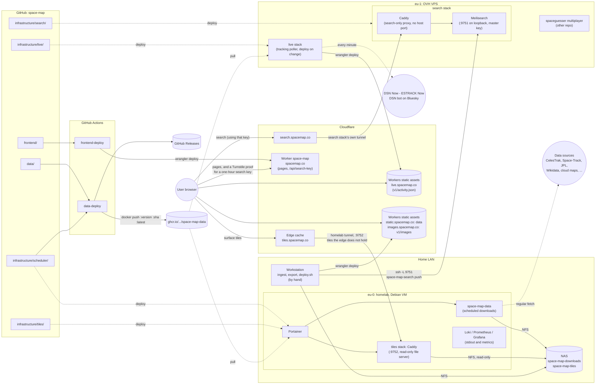

# Infrastructure

## EU-0

The homelab server. See [julie-dujardin/homelab](https://github.com/julie-dujardin/homelab)
for sources. It mounts the NAS, which holds the downloads and the tile tree.
The export and its deploy are not scheduled yet: they run by hand from the
workstation.

## EU-1

The OVH VPS. It has its own disk and no access to the NAS or the LAN, so data
that it needs goes over by rsync. It also runs the multiplayer server of
[spaceguesser](https://github.com/julie-dujardin/spaceguesser).
